# 🛒 Sunny420x POS & Inventory Management System (OpenPOS)

[](https://nodejs.org/)
[](https://expressjs.com/)
[](https://www.mysql.com/)
[](https://getbootstrap.com/)
[](https://opensource.org/licenses/ISC)

ระบบบริหารจัดการหน้าร้าน (Point of Sale) และคลังสินค้าออนไลน์แบบครบวงจร พัฒนาด้วย Node.js, Express, EJS และ MySQL ออกแบบมาให้รองรับสถาปัตยกรรม **Multi-Tenant (แยกหลายบริษัทอย่างสมบูรณ์)** พร้อมระบบตัดสต็อกสูตรวัตถุดิบอัตโนมัติ (Recipe/BOM) และการสลับโหมดการทำงานได้ตามลักษณะธุรกิจ

---

## 🌟 ภาพปกและจุดเด่นระบบ (Showcase & Highlights)

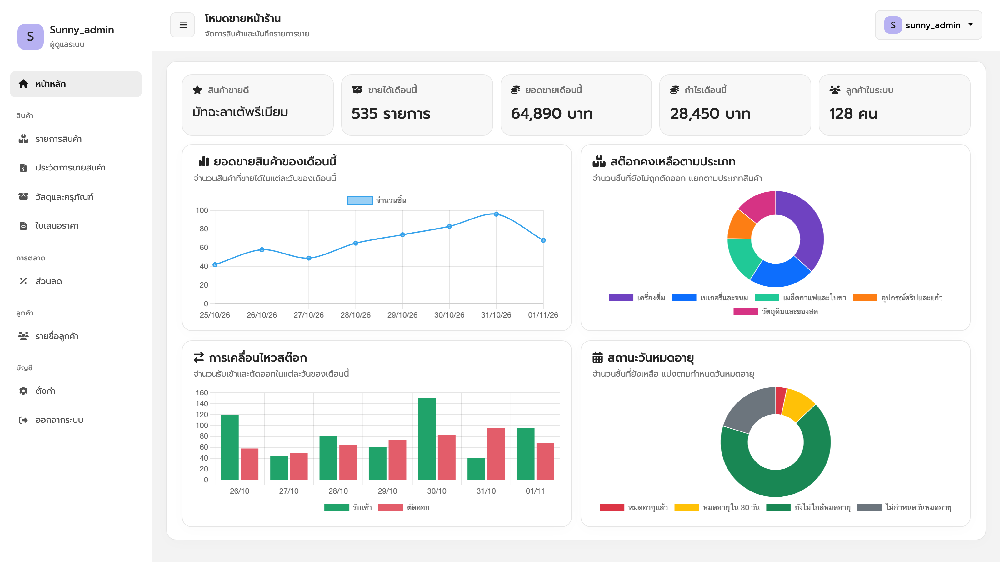

### จุดเด่นสำคัญ (Core Features)
1. 🏢 **Multi-Tenant Architecture**: รองรับการใช้งานหลายบริษัท/หลายธุรกิจในฐานข้อมูลเดียว ด้วย Company Code และ Scoped Database Adapter แยกข้อมูลอย่างปลอดภัย
2. 🔄 **Dual-Mode Operation**: สลับโหมดการทำงานได้ 2 รูปแบบผ่านการตั้งค่า:
   - **POS Mode**: ระบบขายหน้าร้านครบวงจร + ตัดสต็อกสินค้า + ออกใบเสร็จ
   - **Inventory-Only Mode**: โหมดคลังสินค้าล้วน เหมาะกับคลังจัดเก็บหรือหลังบ้าน
3. 🧪 **Asset & Recipe Auto-Deduction (BOM)**: ผูกสูตรสินค้าเข้ากับวัตถุดิบสิ้นเปลือง (เช่น แก้ว, หลอด, กล่อง, ฝา) เมื่อขายสินค้าหน้าร้าน ระบบจะหักสต็อกวัตถุดิบตามสูตรให้อัตโนมัติ
4. 📊 **Real-time Analytics Dashboard**: แดชบอร์ดสรุปยอดขาย, กำไร, สินค้าขายดี, กราฟแนวโน้ม, การเคลื่อนไหวสต็อกเข้า-ออก และแจ้งเตือนสินค้าใกล้หมดอายุ
5. 🧾 **Dual Receipt & Quotation**: รองรับการพิมพ์ใบเสร็จทั้งแบบ **A5 แนวนอน** และ **Thermal Slip 80x80mm** พร้อมระบบออกใบเสนอราคา (Quotation) ก่อนยืนยันตัดสต็อกจริง
6. 🔒 **Enterprise-Grade Security**: จัดเก็บรหัสผ่านด้วย `scrypt`, เซสชัน HttpOnly Cookies, และสิทธิ์การใช้งานตามบทบาท (Admin, Cashier, Stock)

---

## 📸 ภาพรวมฟังก์ชันการทำงาน (Feature Walkthrough)

### 1. ระบบยืนยันตัวตนและจัดการหลายบริษัท (Authentication & Multi-Tenant)
รองรับการสมัครเปิดบัญชีบริษัทใหม่ และการเข้าสู่ระบบโดยระบุ **รหัสบริษัท (Company Code)** ทำให้แต่ละบริษัทเข้าถึงเฉพาะข้อมูลของตนเองอย่างปลอดภัย

| เข้าสู่ระบบ (Login with Company Code) | สมัครเปิดบริษัทใหม่ (Register Company & Admin) |
| :---: | :---: |
| 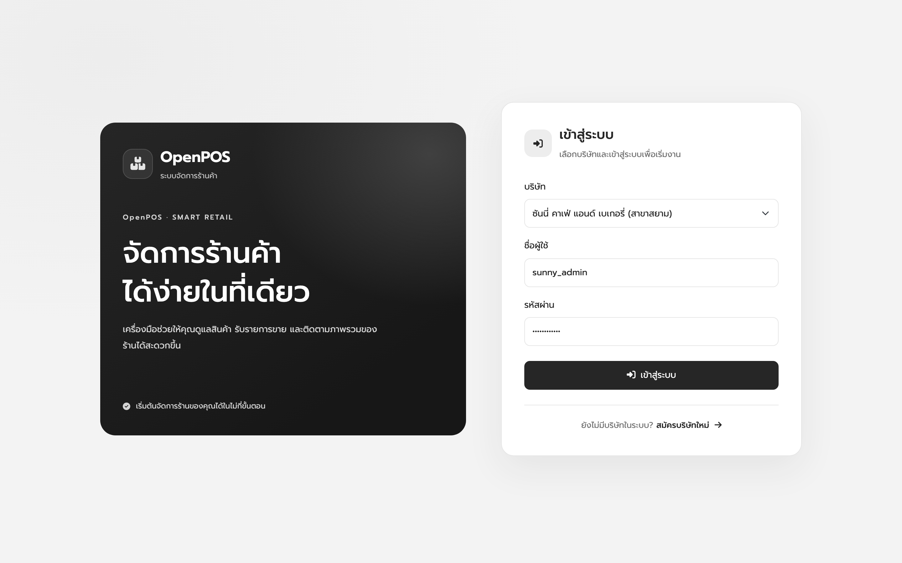 | 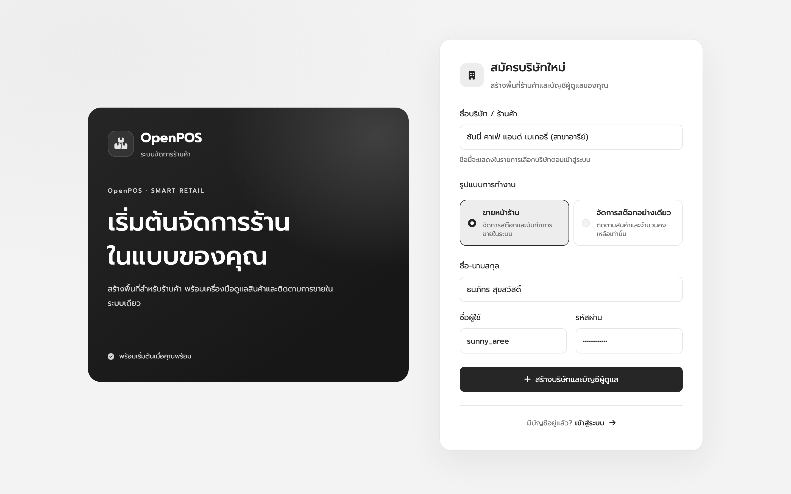 |
| ระบุ Company Code, Username และ Password | กำหนดชื่อบริษัท รหัสบริษัท ข้อมูลติดต่อ และบัญชีผู้ดูแลระบบ |

---

### 2. แดชบอร์ดและสถิติภาพรวม (Dashboard & Analytics)
หน้าหลักแสดงข้อมูลสถิติสำคัญแบบ Real-time ช่วยให้เจ้าของธุรกิจมองเห็นภาพรวมยอดขาย กำไร และสถานะสต็อกได้อย่างแม่นยำ

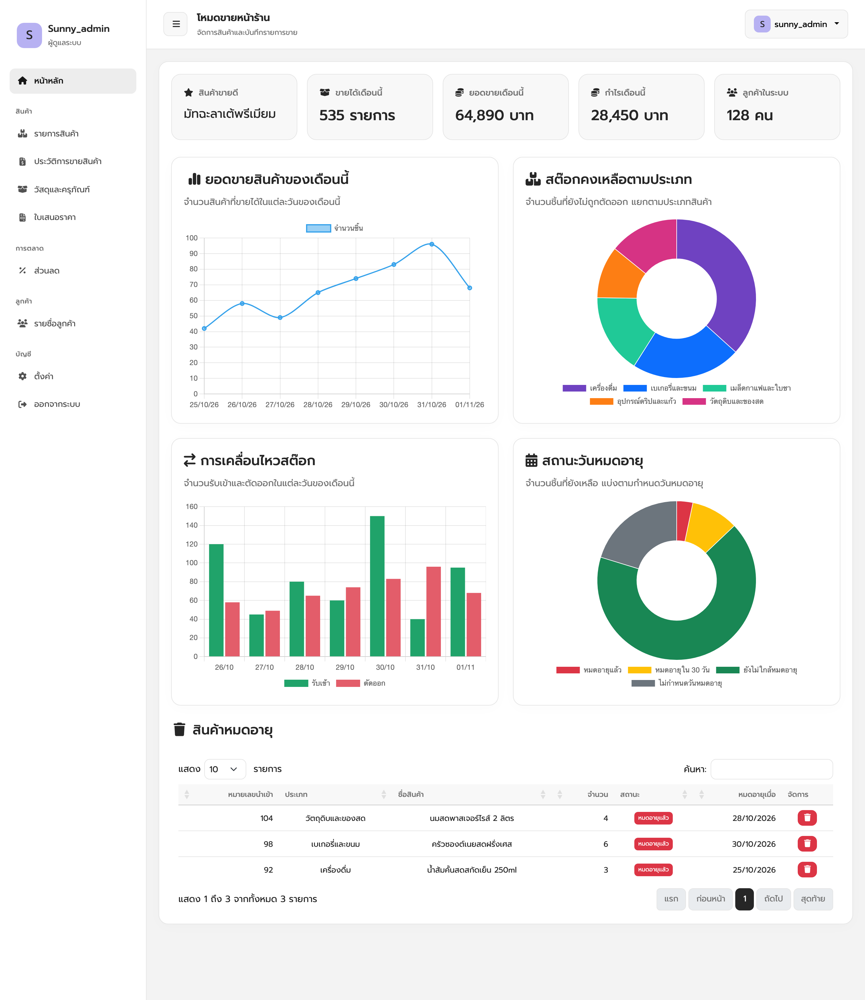

* **สถิติยอดขายและกำไร**: แสดงรายรับรวม กำไร จำนวนลูกค้า และสินค้าขายดีประจำร้าน
* **กราฟวิเคราะห์ยอดขาย**: กราฟแท่งแสดงแนวโน้มยอดขายตามช่วงเวลา และสัดส่วนยอดขายตามหมวดหมู่
* **การเคลื่อนไหวสต็อก (Stock Movement)**: กราฟแท่งคู่เปรียบเทียบจำนวนสินค้าที่รับเข้า (Stock In) และจำหน่ายออก (Stock Out)
* **แจ้งเตือนวันหมดอายุ (Expiry Status)**: วงแหวนแสดงสถานะสินค้าปกติ, ใกล้หมดอายุ (< 30 วัน) และหมดอายุแล้ว เพื่อให้จัดการสินค้าได้ทันท่วงที

> **โหมดคลังสินค้าล้วน (Inventory-Only Mode)**  
> เมื่อเปิดใช้งานโหมดนี้ ระบบจะปรับแดชบอร์ดให้โฟกัสเฉพาะข้อมูลคลังสินค้า การเคลื่อนไหวสต็อก และรายการสินค้าที่ต้องเติม โดยซ่อนเมนูยอดขายหน้าร้านออกไป
> 
> 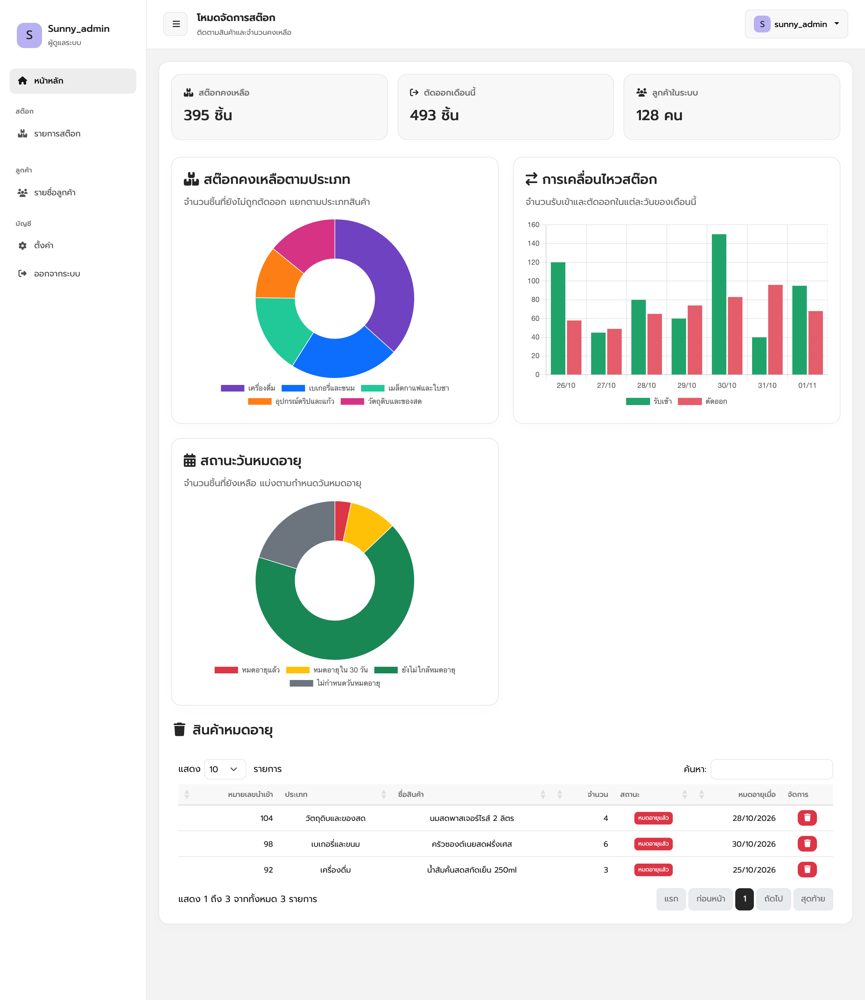

---

### 3. ระบบขายหน้าร้าน (Point of Sale - POS)
ระบบ POS ที่ออกแบบมาเพื่อความคล่องตัวของพนักงานแคชเชียร์ ใช้งานง่ายบนจอสัมผัสหรือคอมพิวเตอร์ทั่วไป

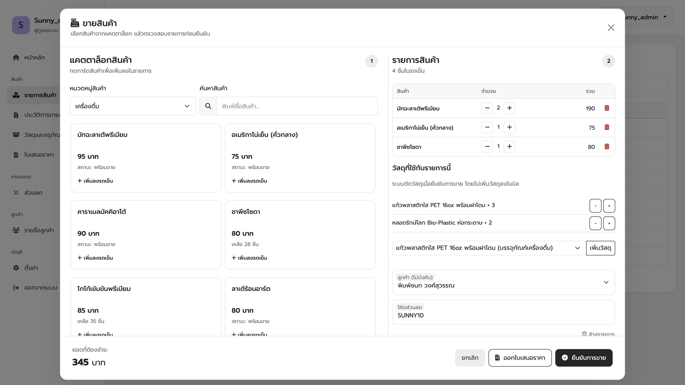

* **ตะกร้าสินค้าอัจฉริยะ**: ค้นหาสินค้าอย่างรวดเร็วด้วยชื่อหรือหมวดหมู่ ปรับจำนวนสินค้าในตะกร้าได้ทันที
* **คำนวณส่วนลด & ภาษี**: เลือกรหัสส่วนลดโปรโมชั่น เลือกลูกค้าสมาชิก และคำนวณเงินทอนอัตโนมัติ
* **ตรวจสอบสต็อกและสูตรวัตถุดิบ**: เช็คสต็อกสินค้าแบบ Real-time พร้อมตัดสต็อกวัตถุดิบตามสูตร (Recipe BOM) ทันทีที่ทำรายการสำเร็จ

| หน้าต่างขายสินค้า (POS Modal) | รายการสินค้าแบบ Grid Catalog |
| :---: | :---: |
| 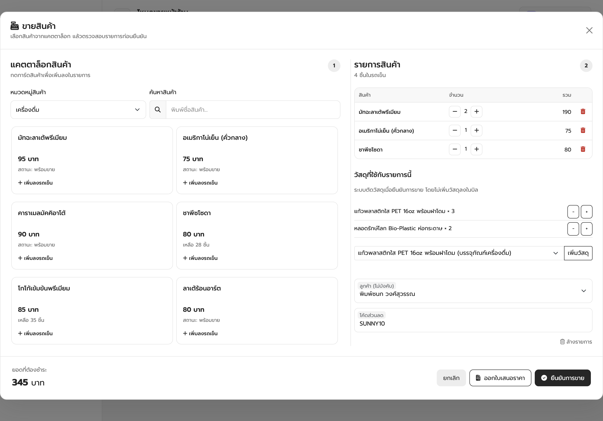 | 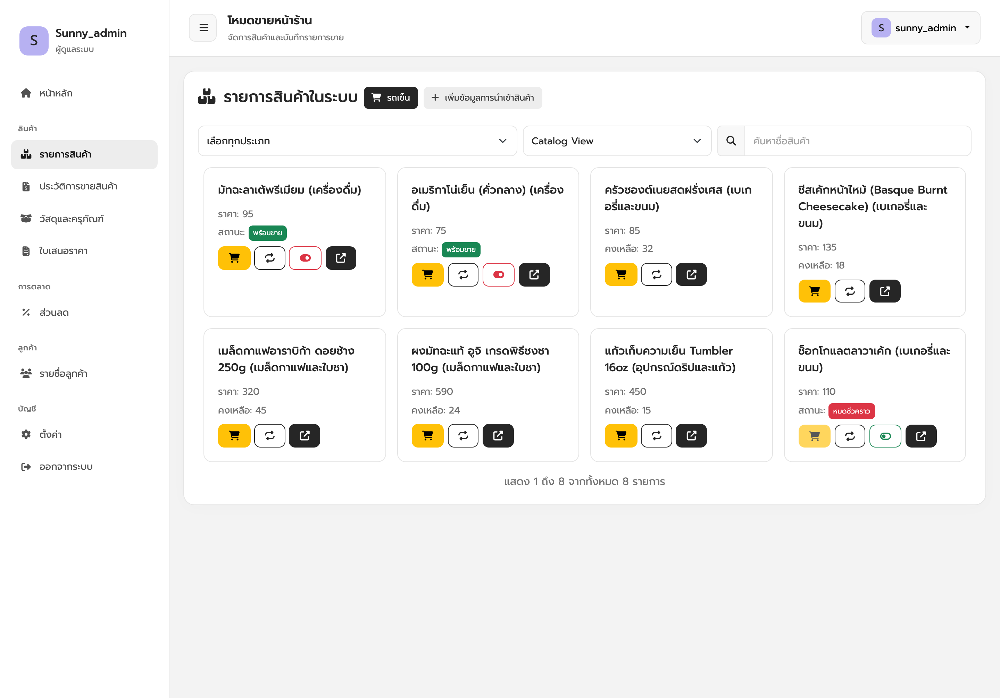 |

---

### 4. ระบบจัดการสินค้าและสต็อก (Products & Stock Management)
จัดการสินค้าอย่างยืดหยุ่น รองรับทั้งสินค้าทั่วไป สินค้าตัดสต็อกตามจำนวน และสินค้าที่เปิด-ปิดสถานะพร้อมจำหน่าย

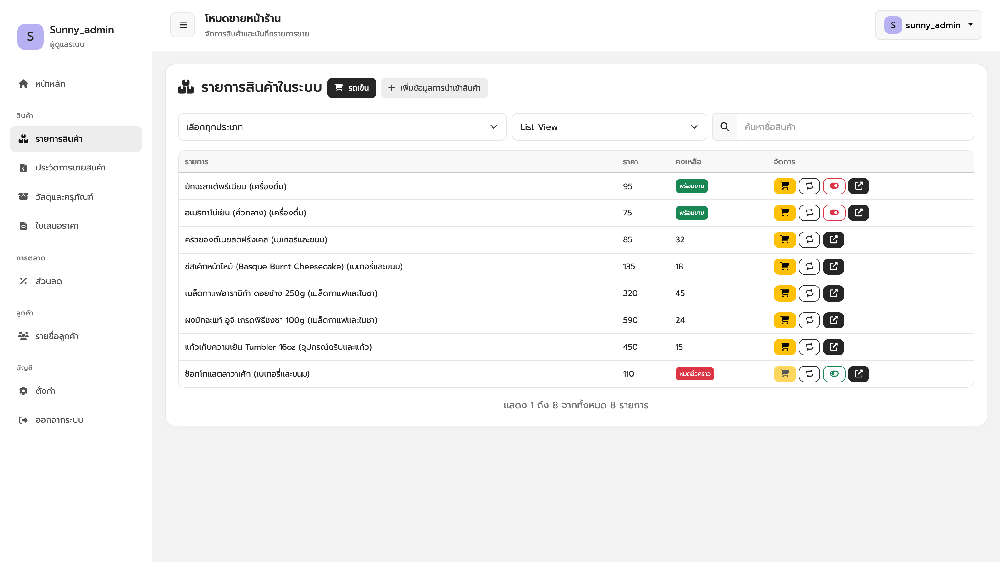

* **Dual Tracking Modes**:
  1. *Quantity-Based*: นับสต็อกตามจำนวนชิ้นจริง ตัดสต็อกอัตโนมัติเมื่อขาย
  2. *Availability-Based*: ควบคุมด้วยสถานะ "พร้อมจำหน่าย / สินค้าหมด" เหมาะกับสินค้าสั่งทำหรือเครื่องดื่ม
* **ประวัติสต็อกละเอียด (Stock History)**: ตรวจสอบการเคลื่อนไหวสต็อก เข้า-ออก วันหมดอายุ หมายเลขล็อต และผู้ทำรายการ
* **การตัดสต็อกแบบ Manual**: รองรับการตัดสต็อกกรณีสินค้าชำรุด สูญหาย หรือนำไปใช้งานภายใน

| รายการสต็อกสินค้า (Stock List) | แบบฟอร์มเพิ่มสินค้าใหม่ (Add Product) |
| :---: | :---: |
| 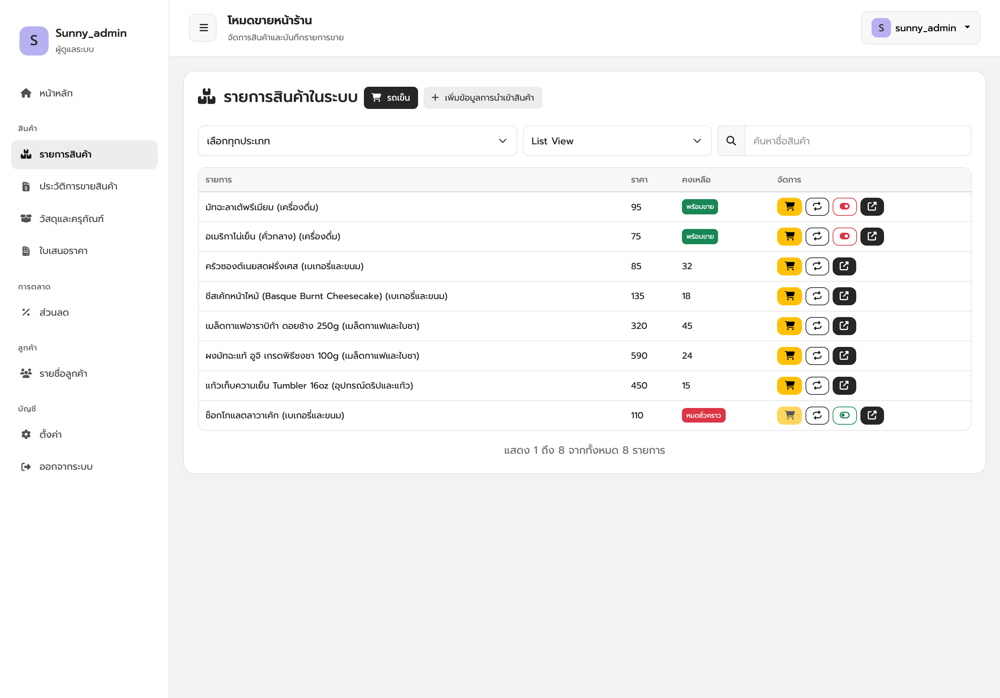 | 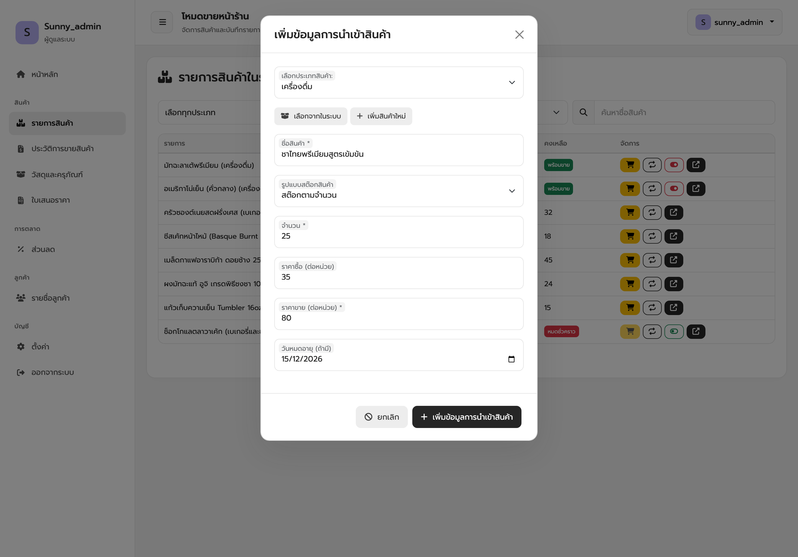 |
| **ตัดสต็อกแบบระบุเหตุผล (Manual Deduct)** | **รายละเอียดประวัติสินค้า (Stock Detail)** |
| 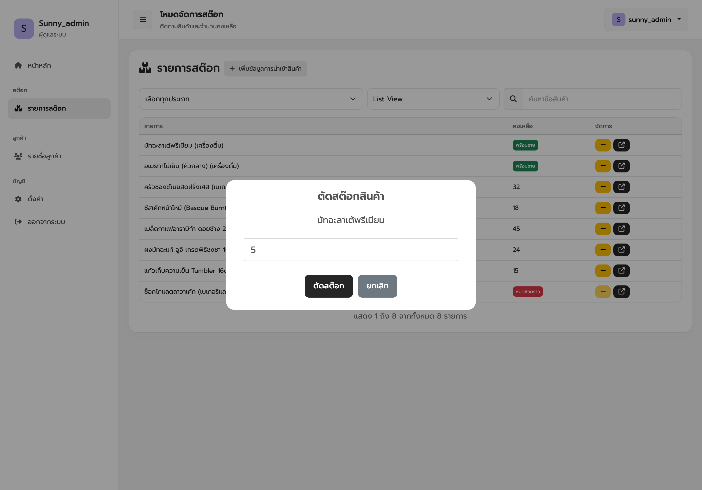 | 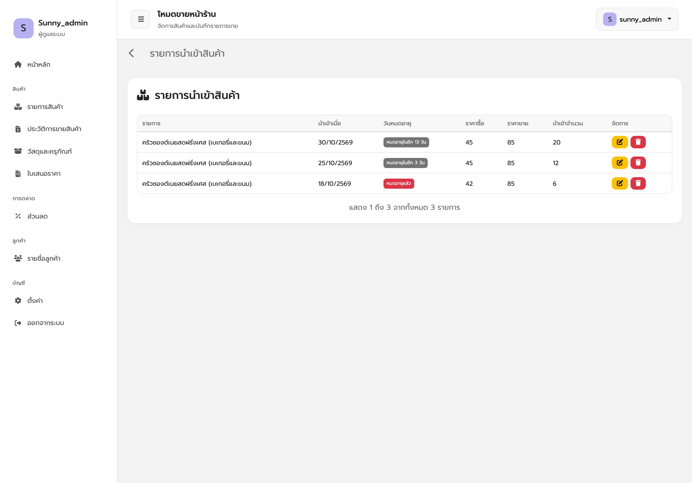 |

---

### 5. ประวัติการขายและใบเสร็จรับเงิน (Billing & Receipts)
เก็บบันทึกประวัติการขายทุกบิล สามารถค้นหา กรองข้อมูลตามวันที่ และพิมพ์ใบเสร็จรับเงินซ้ำได้ตลอดเวลา

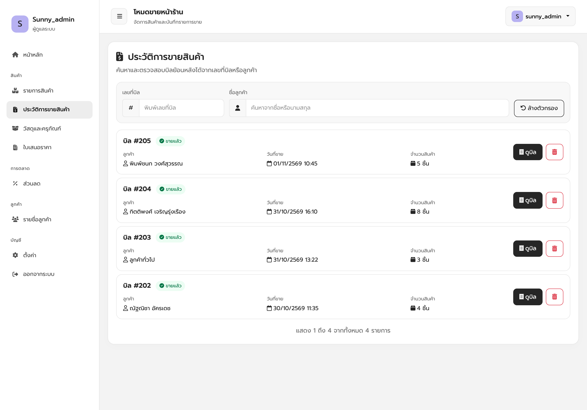

ระบบรองรับรูปแบบใบเสร็จรับเงิน 2 รูปแบบมาตรฐาน:
1. **ขนาด A5 แนวนอน (A5 Landscape Receipt)**: เหมาะสำหรับออกให้ลูกค้าองค์กร ร้านค้าส่ง หรือใบเสร็จแบบเป็นทางการ
2. **ขนาดสลิปความร้อน 80x80mm (Thermal Slip Receipt)**: สลิปขนาดกะทัดรัดสำหรับเครื่องพิมพ์ใบเสร็จความร้อนหน้าร้านทั่วไป

| ใบเสร็จแบบ A5 แนวนอน (A5 Landscape) | สลิปใบเสร็จความร้อน (Thermal 80x80mm) |
| :---: | :---: |
| 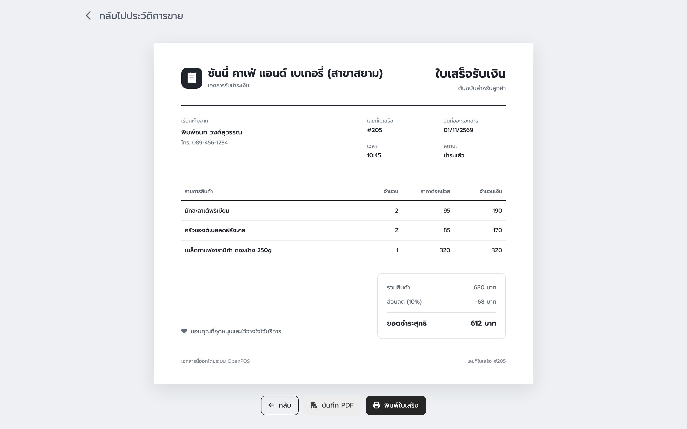 | 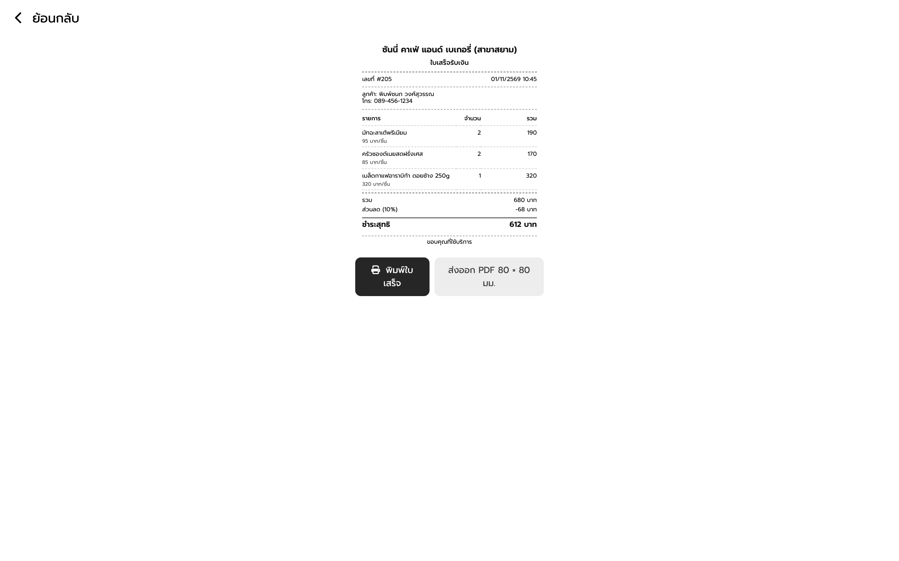 |

---

### 6. ระบบวัตถุดิบและสูตรตัดสต็อก (Assets & Recipe Management)
ฟังก์ชันพิเศษสำหรับธุรกิจร้านกาแฟ เบเกอรี่ ร้านอาหาร หรือธุรกิจประกอบสินค้า ที่ต้องควบคุมสต็อกวัตถุดิบและบรรจุภัณฑ์สิ้นเปลือง

* **คลังวัตถุดิบ (Assets Stock)**: บันทึกสต็อกแก้ว หลอด ฝา ถุงหิ้ว กล่อง เมล็ดกาแฟ ฯลฯ
* **ผูกสูตรสินค้า (Recipe BOM)**: กำหนดว่าสินค้า 1 ชิ้น ต้องใช้วัตถุดิบอะไรบ้าง ปริมาณเท่าใด
* **ตัดสต็อกอัตโนมัติ**: เมื่อพนักงานขายสินค้าหน้าร้าน ระบบจะคำนวณและตัดสต็อกวัตถุดิบที่ผูกไว้ให้ทันทีโดยไม่ต้องคีย์ซ้ำ

| คลังรายการวัตถุดิบ (Assets List) | จัดการสูตรตัดสต็อกสินค้า (Recipe BOM) |
| :---: | :---: |
| 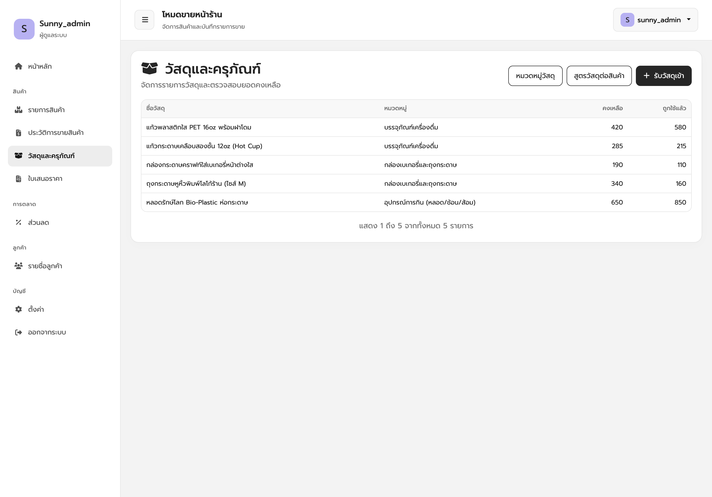 | 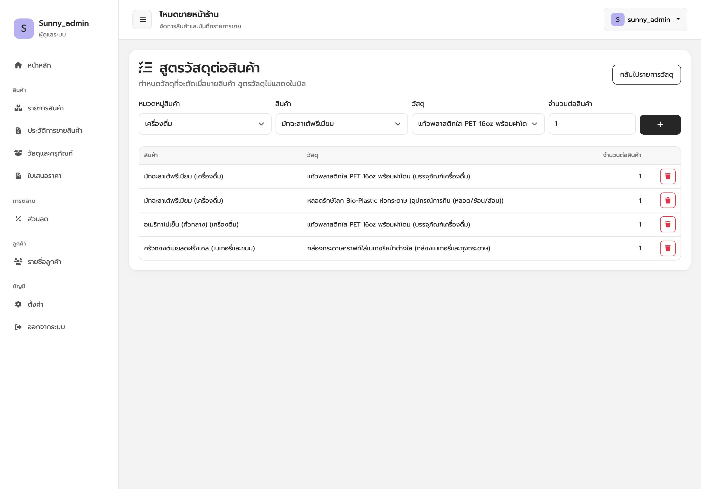 |
| **หมวดหมู่วัตถุดิบ (Asset Types)** | **เพิ่มวัตถุดิบใหม่ (New Asset)** |
| 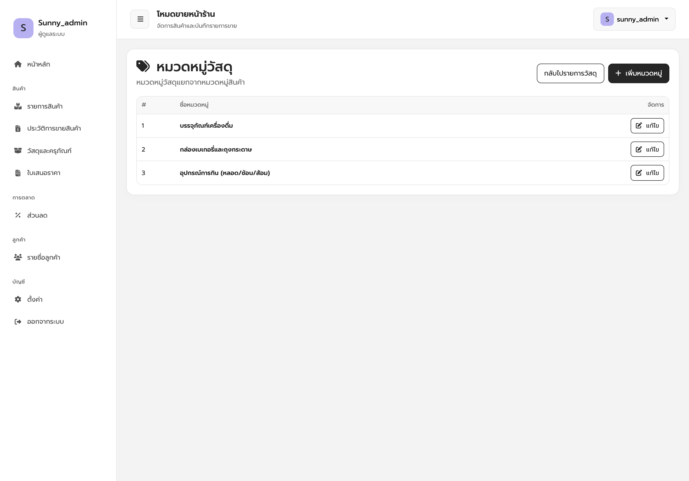 | 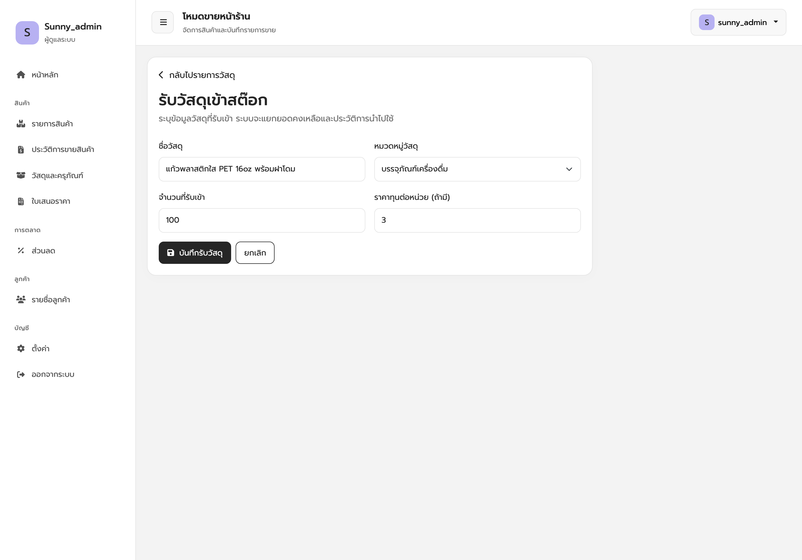 |

---

### 7. ระบบใบเสนอราคา (Quotations)
สร้างและจัดการใบเสนอราคาสำหรับลูกค้า ออกเอกสารล่วงหน้า และมีระบบตรวจเช็คสต็อกก่อนกดยืนยันขายจริง

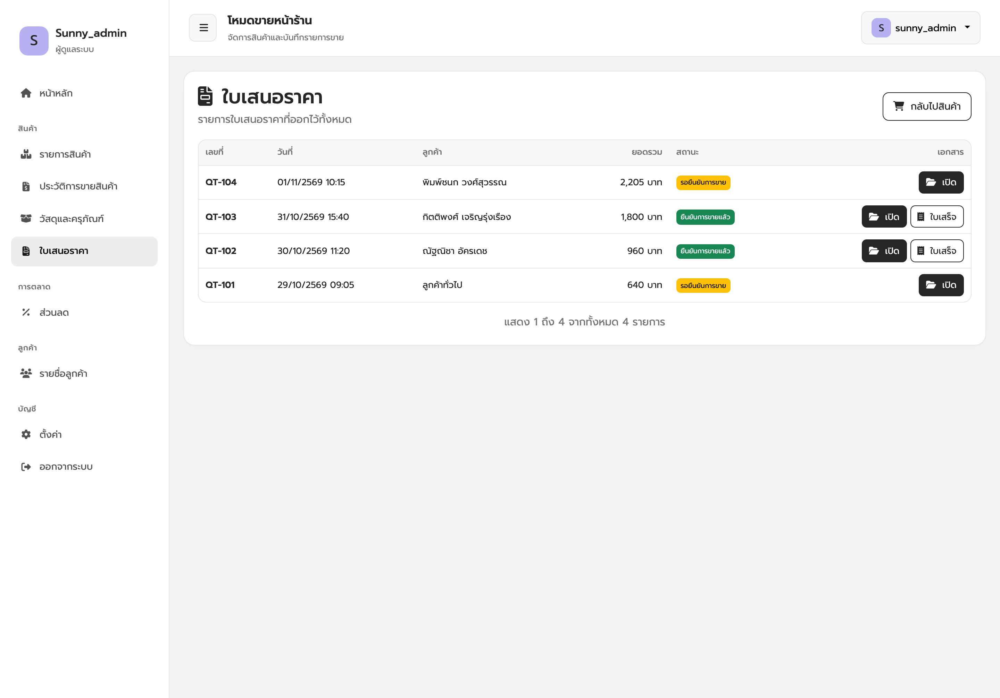

* **ขั้นตอนการทำงาน (Workflow)**:
  1. สร้างใบเสนอราคา ระบุชื่อลูกค้า สินค้า และส่วนลด
  2. รายการจะอยู่ในสถานะ **รอดำเนินการ (Pending)** โดยยังไม่หักสต็อกสินค้า
  3. เมื่อลูกค้าตกลงซื้อ สามารถกด **ยืนยันการขาย (Confirm)** ระบบจะตรวจสอบสต็อกปัจจุบัน หากพร้อมจะทำการแปลงเป็นบิลขายจริงและหักสต็อกทันที

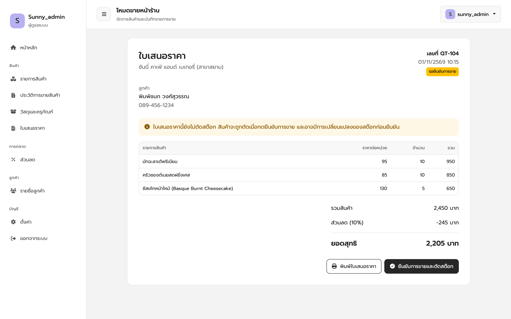

---

### 8. ส่วนลดและโปรโมชั่น (Discounts & Promotions)
สร้างแคมเปญโปรโมชั่นส่งเสริมการขายหน้าร้าน เพิ่มยอดขายและดึงดูดลูกค้า

| รายการส่วนลด (Discounts List) | สร้างส่วนลดใหม่ (Add Discount) |
| :---: | :---: |
| 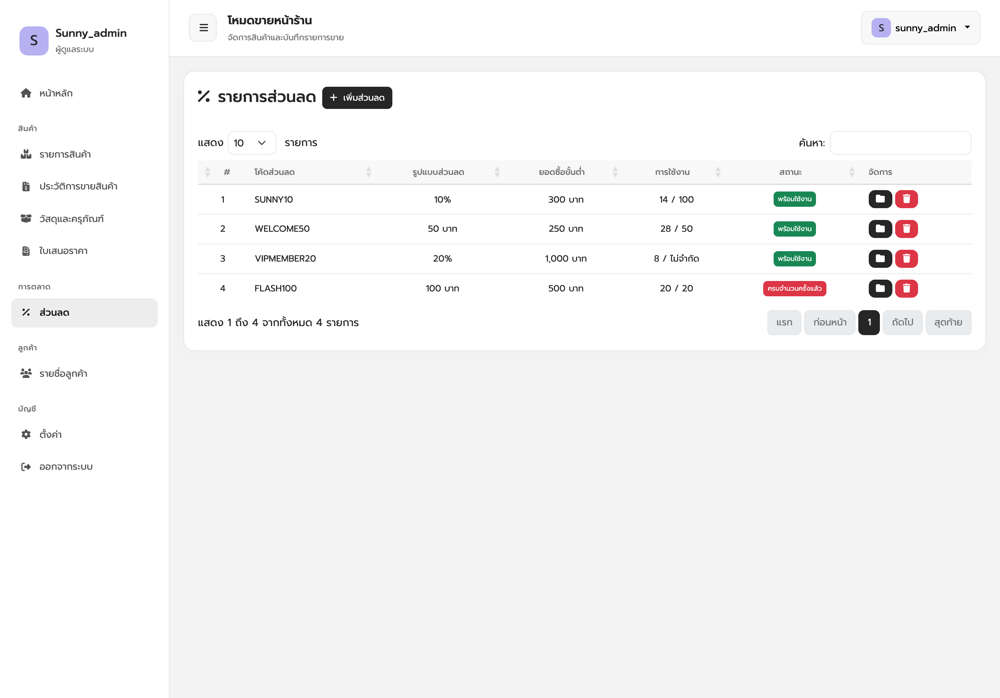 | 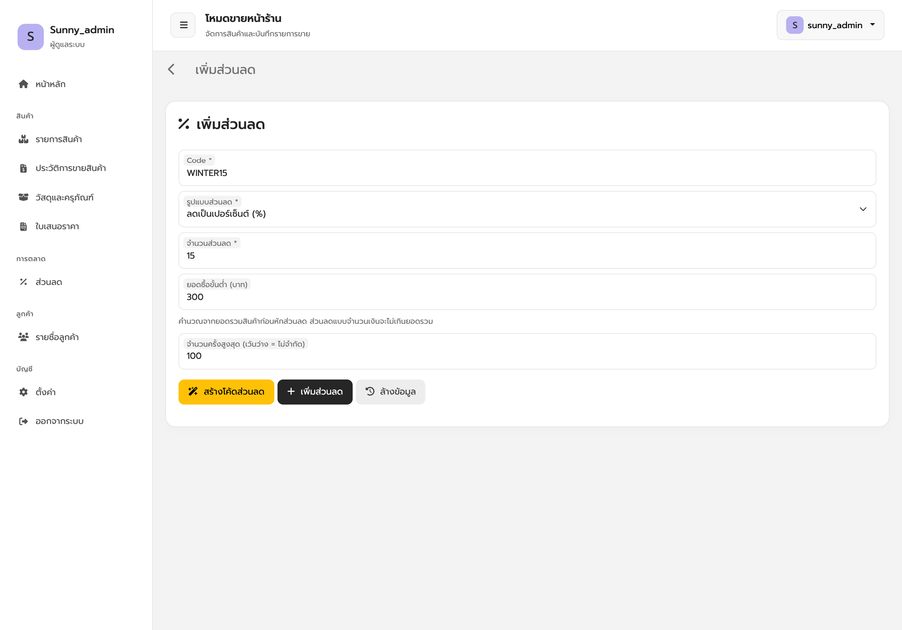 |

* กำหนดประเภทส่วนลดได้ทั้งแบบ **เปอร์เซ็นต์ (%)** หรือ **ลดเป็นจำนวนเงินบาท (Fixed Amount)**
* กำหนดยอดสั่งซื้อขั้นต่ำ และจำกัดจำนวนครั้งสูงสุดที่สามารถใช้ได้
* กำหนดวันเริ่มต้นและวันหมดอายุของโปรโมชั่น

---

### 9. ฐานข้อมูลลูกค้า (Customer CRM)
เก็บบันทึกข้อมูลลูกค้า เพื่อเพิ่มความสะดวกรวดเร็วในการออกใบเสร็จและใบเสนอราคา

| รายชื่อลูกค้า (Customers List) | เพิ่มข้อมูลลูกค้าใหม่ (Add Customer) |
| :---: | :---: |
| 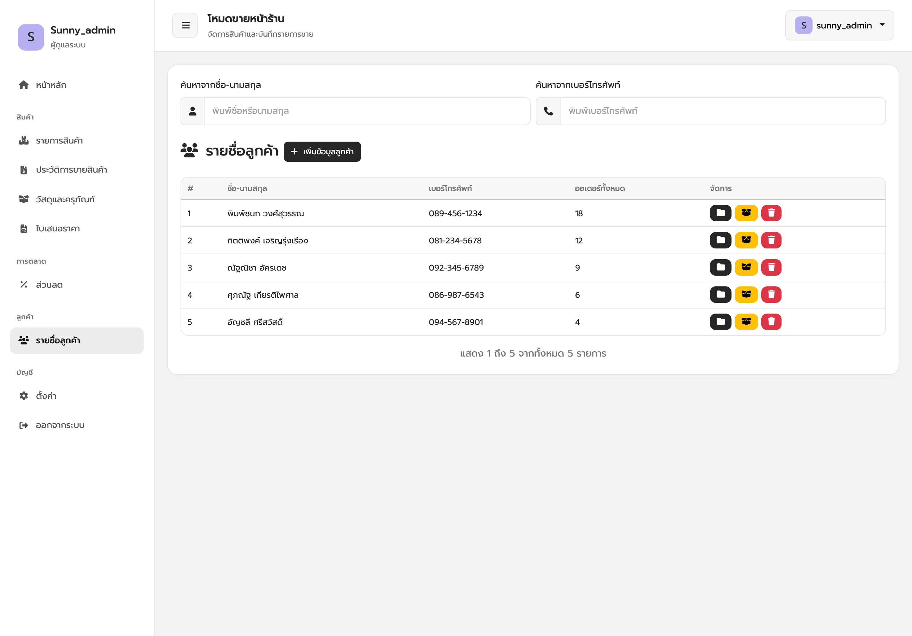 | 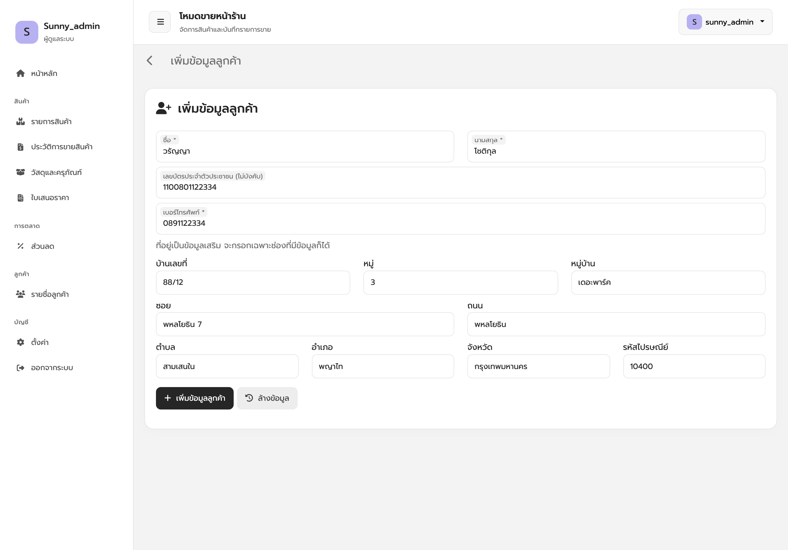 |

* บันทึกชื่อ ที่อยู่ เบอร์โทรศัพท์ และอีเมล
* ดูสถิติจำนวนครั้งที่ลูกค้ามาอุดหนุน (Purchase Orders Count)

---

### 10. การตั้งค่าระบบ สิทธิ์ และผู้ใช้งาน (Settings & Administration)
ควบคุมการทำงานของทั้งระบบอย่างปลอดภัยด้วยระบบ Role-Based Access Control และ Audit Log

| การตั้งค่าระบบ (System Settings) | กำหนดบทบาทและสิทธิ์ (User Roles / Types) |
| :---: | :---: |
| 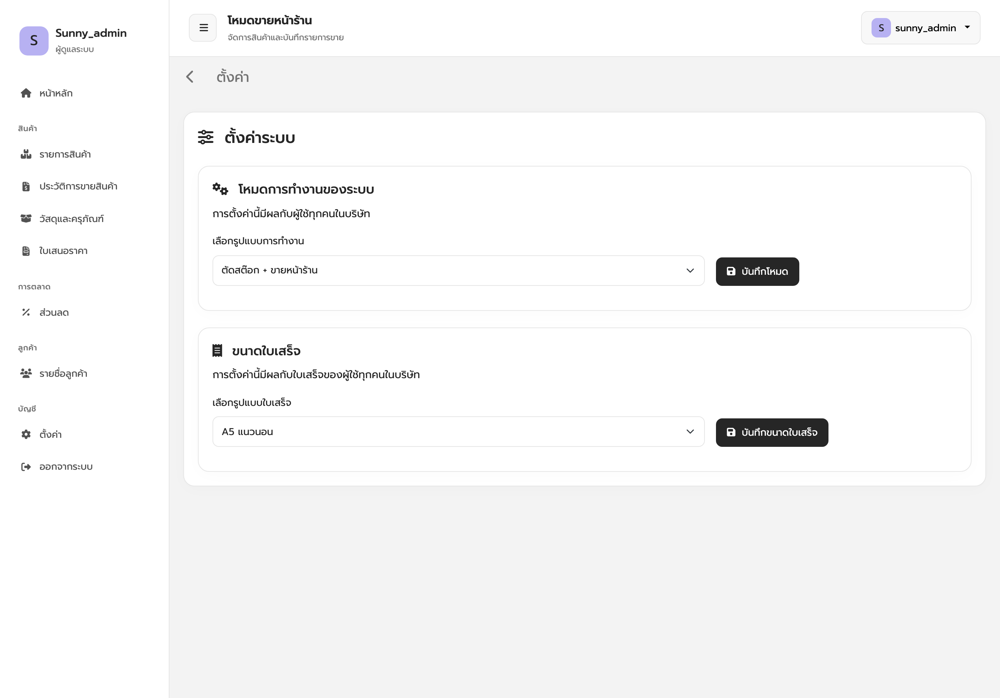 | 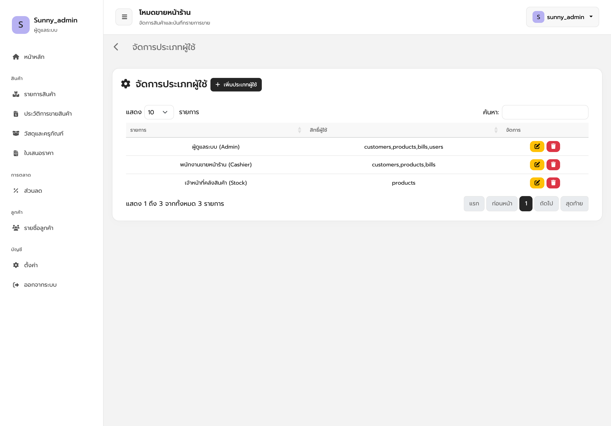 |
| **รายชื่อผู้ใช้งานในระบบ (Users List)** | **บันทึกประวัติการเข้าใช้งาน (Login Audit Logs)** |
| 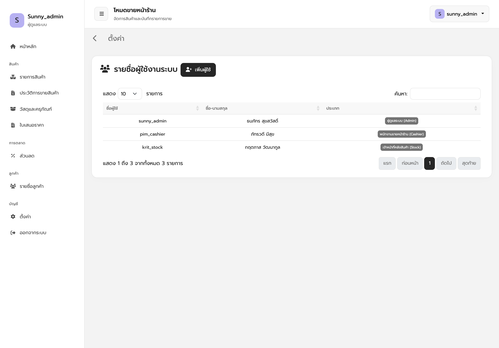 | 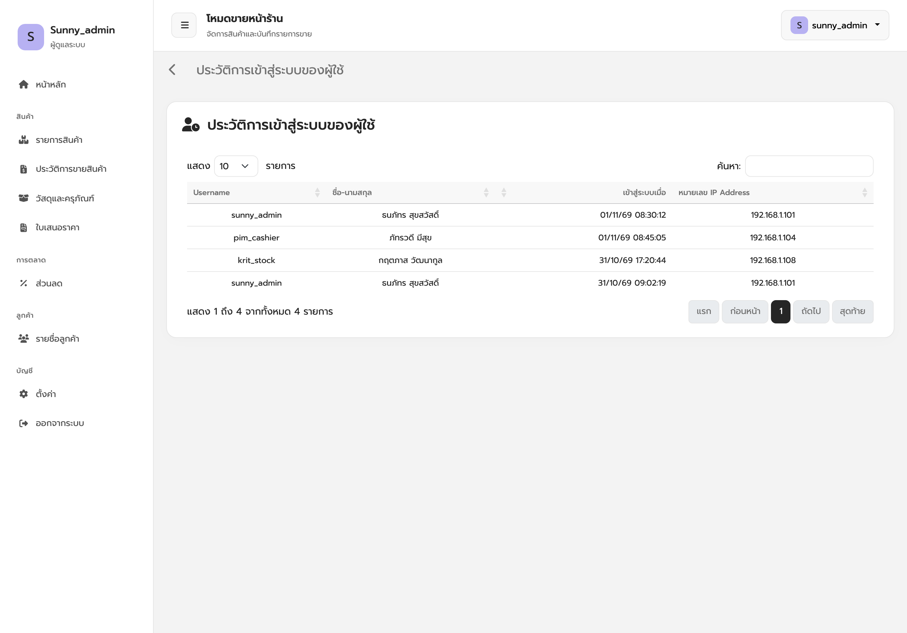 |

* **System Settings**: สลับโหมดการทำงานระหว่าง `POS Mode` หรือ `Inventory-Only Mode`, กำหนดชื่อร้าน, ข้อมูลหัวบิล, นโยบายใบเสร็จ
* **Role Permissions**: กำหนดระดับสิทธิ์ เช่น Admin (จัดการได้ทุกส่วน), Cashier (เฉพาะงานขายและออกบิล), Stock Keeper (จัดการเฉพาะคลังสินค้า)
* **Audit & Login Histories**: บันทึก IP Address, Browser User-Agent, และวันเวลาที่ผู้ใช้งานแต่ละคนเข้าสู่ระบบเพื่อความโปร่งใส

---

## 🛠️ สถาปัตยกรรมและเทคโนโลยีที่ใช้ (Tech Stack)

```
sunny420x-pos/
├── app.js               # Express application setup, routes & controllers
├── database.js          # MySQL connection pool & scoped tenant wrapper
├── middleware/
│   ├── auth.js          # Authentication & session token verification
│   ├── password.js      # Scrypt password hashing & backward-compat SHA-256
│   └── tenant.js        # Multi-tenant SQL rewriting & company isolation
├── model/               # Business logic & Database queries (Product, Sale, Asset, etc.)
├── schema/
│   ├── pos.sql          # Canonical MySQL database schema
│   └── sync.js          # Automatic database schema synchronization on startup
├── public/              # Static assets (CSS, JS, Icons, Screenshots)
│   └── screenshots/     # Showcase and feature screenshots
└── views/               # EJS template engine pages and partials
```

* **Backend Engine**: [Node.js](https://nodejs.org/) & [Express.js](https://expressjs.com/)
* **Database**: [MySQL](https://www.mysql.com/) / MariaDB พร้อมระบบ Auto-migration (`schema/sync.js`)
* **Template Engine**: [EJS (Embedded JavaScript templates)](https://ejs.co/)
* **Frontend UI**: [Bootstrap 5](https://getbootstrap.com/), [DataTables](https://datatables.net/), [SweetAlert2](https://sweetalert2.github.io/)
* **Charts & Visualizations**: [Chart.js](https://www.chartjs.org/)
* **Security**: Multi-tenant isolation, HttpOnly session cookies, Scrypt password hashing with Salt

---

## 🚀 วิธีการติดตั้งและเริ่มต้นใช้งาน (Installation & Setup)

### 1. ความต้องการของระบบ (Prerequisites)
* **Node.js** เวอร์ชัน 18.x ขึ้นไป
* **MySQL** หรือ **MariaDB** เวอร์ชัน 8.0 ขึ้นไป
* **NPM** หรือ **Yarn**

### 2. โคลนโปรเจ็คและติดตั้ง Dependencies
```bash
git clone https://github.com/your-username/sunny420x-pos.git
cd sunny420x-pos
npm install
```

### 3. ตั้งค่าสภาพแวดล้อม (Environment Configuration)
สร้างไฟล์ `.env` จากตัวอย่าง `.env.example`:
```bash
cp .env.example .env
```

แก้ไขค่าในไฟล์ `.env` ให้ตรงกับระบบฐานข้อมูลของคุณ:
```env
# Server Information
PORT = 3000

# Database Configuration
MYSQL_HOST = localhost
MYSQL_USERNAME = root
MYSQL_PASSWORD = your_mysql_password
MYSQL_DATABASE = pos_database

# Security Salt for Password Hashing
CRYPTO_SALT = your_secret_salt_key_here
```

### 4. ซิงค์ฐานข้อมูล (Database Synchronization)
ระบบมีฟังก์ชัน **Auto Schema Sync** ในตัว เมื่อเริ่มรันโปรแกรม `schema/sync.js` จะทำการอ่านไฟล์ `schema/pos.sql` และตรวจสอบโครงสร้างตาราง คอลัมน์ และ Index ในฐานข้อมูลให้อัตโนมัติ:
```bash
# คุณสามารถสร้างฐานข้อมูลเปล่าใน MySQL ก่อน:
# CREATE DATABASE pos_database CHARACTER SET utf8mb4 COLLATE utf8mb4_unicode_ci;
```

### 5. เริ่มต้นการทำงาน (Run Application)
```bash
# โหมด Production
npm start

# หรือโหมด Development (Hot Reload ด้วย nodemon)
npm run dev
```

เปิดเว็บเบราว์เซอร์ไปที่:
```
http://localhost:3000
```

---

## 🧪 การทดสอบระบบ (Testing)

โปรเจ็คมีชุด Unit Test และ Query Verification ในตัว สามารถรันคำสั่ง:
```bash
# ทดสอบระบบ Authentication และ Password Hashing
node --test tests/auth.test.js

# ทดสอบ SQL Queries และ Tenant Isolation
node tests/queries.cjs
```

---

## 📄 ใบอนุญาต (License)

โปรเจ็คนี้เผยแพร่ภายใต้สัญญาอนุญาต [ISC License](LICENSE) สามารถนำไปพัฒนาต่อยอดได้ตามต้องการ

